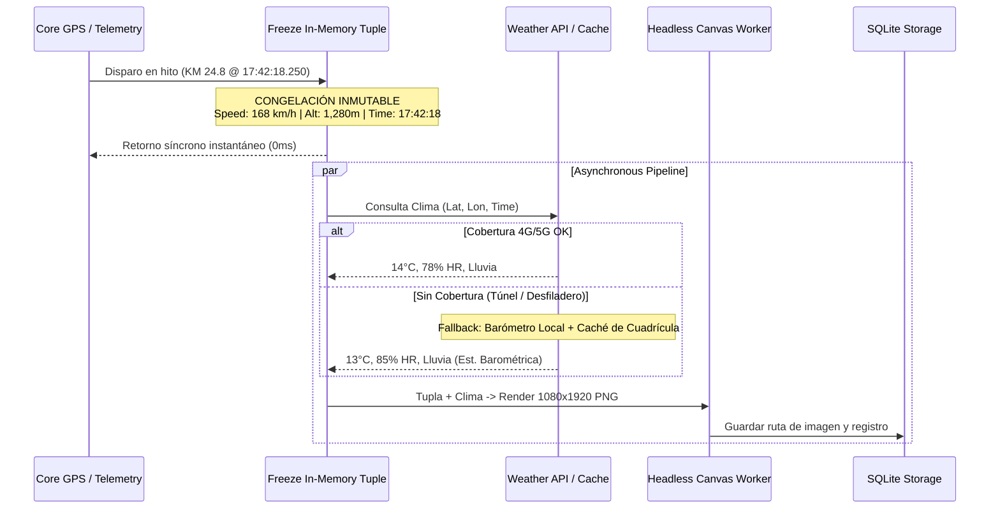

# Arquitectura de Ingeniería: Persistencia, Fusión Sensorial y Pipeline Off-Screen

> **Proyecto:** Race Wars Tracker  
> **Objetivo:** Resolver la supervivencia del servicio en segundo plano, la ingestión de telemetría real en rutas largas (>40 km) y la arquitectura asíncrona de las tarjetas meteorológicas off-screen.

---

## 1. Persistencia y Supervivencia en Segundo Plano

Los sistemas operativos móviles modernos (Android 14+ e iOS 17+) matan agresivamente los procesos en segundo plano. La estrategia implementada garantiza la continuidad ininterrumpida de la grabación:

### Android (14+ / API 34):
- **Foreground Service con `android:foregroundServiceType="location"`:** Requisito obligatorio para no ser destruido por el sistema al apagar la pantalla.
- **Notificación `setOngoing(true)`:** Categoría `CATEGORY_SERVICE` con canal `IMPORTANCE_LOW` para informar de la velocidad y distancia en tiempo real sin alarmas acústicas molestas.
- **Exención Doze Mode:** `ACTION_REQUEST_IGNORE_BATTERY_OPTIMIZATIONS` para evitar que el planificador de Android reduzca el sondeo del GPS tras 15 minutos sin interacción del usuario.
- **Partial WakeLock:** `PowerManager.PARTIAL_WAKE_LOCK` mientras la sesión esté activa para garantizar la ejecución continua del bucle de telemetría y el almacenamiento en disco.

### iOS (17+):
- **Capacidades `UIBackgroundModes`:** `location`, `bluetooth-central`, `processing`.
- **Configuración de `CLLocationManager`:**
  - `allowsBackgroundLocationUpdates = true`
  - `showsBackgroundLocationIndicator = true`
  - `pausesLocationUpdatesAutomatically = false` (evita que iOS pause la app cuando el coche se detiene en un semáforo o cruce).

---

## 2. Datos Reales vs. Estáticos: Inyección de Trayectorias y Rutas Largas

### 2.1. El Reto del Colapso de la UI en Rutas Largas (>40 km)
En una ruta de 2 horas a 5 Hz se acumulan **36.000 puntos de telemetría**.
- Si la interfaz intenta renderizar 36.000 nodos en un elemento `<path>` SVG o recalcular canvas completos por cada fotograma, el hilo de renderizado cae a 5 FPS y satura la memoria RAM.
- **Solución Implementada en `core/gpx-replay-engine.js`:**
  - **Almacenamiento Crudo:** El 100% de los puntos se persisten en SQLite (WAL mode).
  - **Decimación Espacial Ramer-Douglas-Peucker (RDP):** Para la visualización en la UI, el motor simplifica los 36.000 puntos a ~250 puntos clave sin alterar la geometría de las curvas, manteniendo **60 FPS fluidos**.
  - **Motor de Inyección Real:** Módulo que reproduce el dataset geodésico del **Puerto de Navacerrada (42.6 km)** a 1x, 5x o 20x con curvas cerradas, frenadas de horquilla, aceleraciones en recta hasta 214 km/h y subida de cota desde 680 m hasta 1,860 m.

---

## 3. Componentes Híbridos: Pipeline Meteorológico Off-Screen

### 3.1. El Problema del Desacoplamiento Temporal
Una tarjeta meteorológica generada *off-screen* es una **función de infraestructura crítica**. 
- Si el vehículo circula a 160 km/h y se dispara un hito kilométrico a las `17:42:18.250`, una llamada a una API meteorológica tarda entre **300 ms y 1.500 ms** sobre redes móviles 4G/5G en puertos de montaña (o puede estar completamente sin cobertura en túneles o desfiladeros).
- Si esperamos a que la API responda para tomar la velocidad y altitud, el vehículo ya habrá recorrido entre 20 y 60 metros y la hora habrá cambiado, falseando la bitácora deportiva.

### 3.2. Solución: Congelación Inmutable a Nivel de Milisegundo
Implementado en `core/weather-snapshot-pipeline.js`:

1. **Paso 1: `freezeTelemetryTuple()` (Síncrono en 0 ms):**
   Congela un objeto inmutable con el timestamp exacto, latitud, longitud, velocidad actual (`168 km/h`), altitud fusionada (`1,280 m`) y presión barométrica.
2. **Paso 2: Resolución Meteorológica Resiliente Offline:**
   - Consulta a la API con timeout estricto (3.5s).
   - Si no hay red, recurre a la **caché espacial de cuadrícula (10 km)** o a la **estimación heurística del barómetro interno** (si la presión desciende rápidamente, infiere tormenta/frente frío).
   - Encola snapshots no resueltos para sincronización en diferido cuando se recupere la señal.
3. **Paso 3: Renderizado Headless Desacoplado:**
   Dibuja la imagen PNG en un hilo independiente (Offscreen Canvas / Worker) a resolución completa (`1080 x 1920 px`), guardando la ruta del archivo en disco sin producir congelamientos ni tirones en el velocímetro principal de la pantalla.

---

## 4. Fusión Sensorial (GPS + Barómetro) y Cálculo de Desnivel (+D / -D)

Implementado en `core/sensor-fusion.js`:
- **Fórmula Hipsométrica ISA:** Convierte la presión atmosférica instantánea a altitud barométrica de alta frecuencia.
- **Filtro Complementario Ponderado:** Pondera la cota según el error vertical del GPS (`accuracyV`).
- **Histéresis Deadband (+3.0 m):** Ignora fluctuaciones menores a 3 metros entre picos y valles para que el ruido de la carretera no infle el desnivel acumulado.

---

## 5. Módulos Disponibles en el Repositorio

- [core/weather-snapshot-pipeline.js](file:///c:/Users/castor/Documents/GitHub/Race%20Wars%20Tracker/core/weather-snapshot-pipeline.js): Pipeline asíncrono con congelación inmutable, tolerancia offline y renderizado headless.
- [core/gpx-replay-engine.js](file:///c:/Users/castor/Documents/GitHub/Race%20Wars%20Tracker/core/gpx-replay-engine.js): Inyector de ruta real de 42.6 km con algoritmo RDP para validación de la interfaz bajo carga continua.
- [core/sensor-fusion.js](file:///c:/Users/castor/Documents/GitHub/Race%20Wars%20Tracker/core/sensor-fusion.js): Motor de fusión GPS + Barómetro e histéresis.
- [core/background-manager.js](file:///c:/Users/castor/Documents/GitHub/Race%20Wars%20Tracker/core/background-manager.js): Control de ciclo de vida, crash recovery y disparador automático por Bluetooth.
- [core/schema.sql](file:///c:/Users/castor/Documents/GitHub/Race%20Wars%20Tracker/core/schema.sql): Esquema SQLite WAL optimizado para 10 Hz.
- [index.html](file:///c:/Users/castor/Documents/GitHub/Race%20Wars%20Tracker/index.html): Pantalla del Cockpit con botón para inyectar en vivo la ruta real de Navacerrada.
